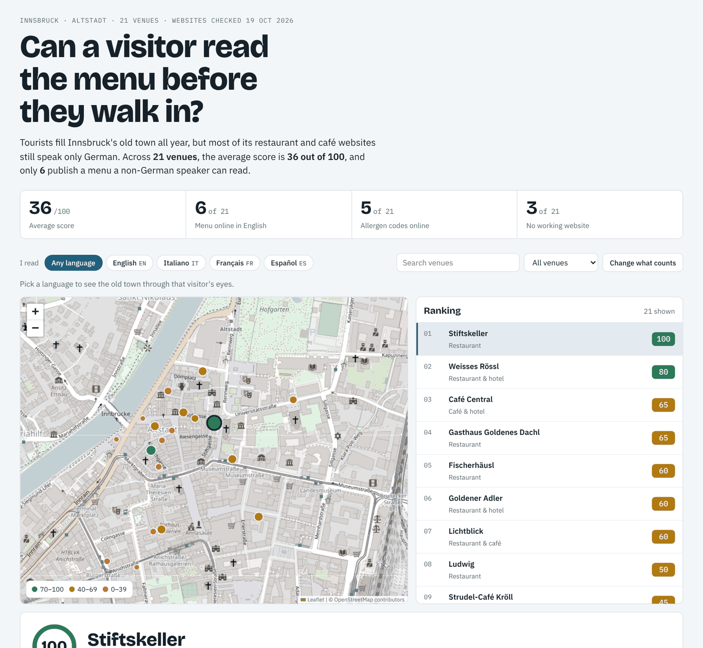

# Innsbruck Tourist-Friendliness Index

**Can a visitor read the menu before they walk in?**

Innsbruck's old town is full of tourists all year, but most of its restaurant and café websites still speak only German. This project audits what a non-German-speaking visitor can actually find online (languages, menus, allergen information, booking) and turns it into an open, interactive index.

**[→ Open the interactive map](https://YOUR-USERNAME.github.io/tourist-friendliness-index/)** <!-- replace after enabling GitHub Pages -->



## Key findings (pilot, October 2026)

| | |
|---|---|
| Venues audited | 21 restaurants, cafés and bars in and around the Altstadt |
| Average score | **36 / 100** |
| Menu online in English (or more languages) | **6 of 21** |
| EU allergen codes on the online menu | **5 of 21** |
| No working website at all | **3 of 21** |

- **One venue scores 100.** Stiftskeller publishes its full menu in five languages with an allergen legend and an online request form. It proves the standard is reachable.
- **Menu languages and website languages are the biggest gaps.** Venues collect only about a quarter of the possible points for each.
- **Good menus often sit on German-only websites.** Gasthaus Goldenes Dachl has a four-language menu, but a visitor has to find it on a site that is only in German.
- **"Online" doesn't always mean readable.** Some menus are scanned images or photos, which phone translation apps and search engines can't read. One main menu link points to a file that no longer exists.
- **Domains decay.** One historic wine tavern's old domain now hosts a third-party article about it, and another venue's domain forwards to a different restaurant.

## What you can do on the site

- **Read it as a visitor.** Pick English, Italiano, Français or Español, and the map and ranking re-sort around the places that serve you.
- **Change what counts.** Drag the weights to decide how much each criterion matters to you, and watch the ranking change.
- **Open any venue** for its score breakdown, the languages it offers, and its quick wins: the cheapest fixes, biggest gain first.
- **Link to a venue** with `#venue-name`, for example `#stiftskeller`.

## How the score works

Six things a visitor needs before walking in, worth 100 points together:

| Criterion | Points | How it's scored |
|---|---|---|
| Website works | 10 | The venue's own website loads and shows real content. |
| Website languages | 25 | 2 languages = 15, 3 or more = 25. |
| Menu online | 15 | A food menu is reachable from the website. |
| Menu languages | 25 | Partly translated = 5, German + English = 15, 3+ languages = 25. Image-only menus score 0 here. |
| Allergen info online | 15 | EU allergen letter codes (A–R) on each dish, or a legend. "Ask our staff" doesn't count. |
| Book or order online | 10 | Online reservation, request form or webshop. Phone and email don't count. |

The full rubric lives in [`data/rubric.json`](data/rubric.json); scoring logic is in [`scripts/score.py`](scripts/score.py).

## Method: crawler first, human review second

1. **Automated crawl** ([`scripts/audit.py`](scripts/audit.py)). For each venue, a Python crawler:
   - loads the homepage and detects language versions from `hreflang` tags, language switchers and `/en/`-style paths
   - finds menu links and downloads menu PDFs and pages
   - extracts text from PDFs and flags image-only (scanned) menus
   - estimates which languages the dishes are written in, using menu-specific vocabulary per language
   - checks for real allergen information: a legend naming most of the 14 EU allergens, or letter codes on the dishes, not just "ask our staff"
   - looks for online booking and ordering, and flags off-topic content such as casino advertising

   The raw output is kept in [`data/raw/auto_audit.json`](data/raw/auto_audit.json).

2. **Human review.** Every finding was checked by hand before it went into [`data/venues.csv`](data/venues.csv). The two caught different things. The crawler found English and Italian site versions that the first manual pass missed. Manual review caught a "Menü" page with no dishes on it and a café that tags each item with allergen letters but has no legend. A stricter allergen rule added after review also corrected one of the manual findings: a burger restaurant whose menu only says to ask the staff.

3. **Scoring and site build** ([`scripts/score.py`](scripts/score.py), [`scripts/build_site.py`](scripts/build_site.py)). Scores, quick wins and summary figures are computed from the reviewed data and written to `docs/data/`, which the site reads.

**What is not measured:** printed menus in the venue, staff language skills, food quality, and Google review replies (planned for the next round).

## Run it yourself

```bash
git clone https://github.com/YOUR-USERNAME/tourist-friendliness-index.git
cd tourist-friendliness-index
pip install -r requirements.txt

python scripts/audit.py          # crawl every venue in data/venues_seed.csv (a few minutes)
python scripts/audit.py "Ludwig" # or just one venue
python scripts/geocode.py        # add map coordinates for new rows in data/venues.csv
python scripts/score.py          # score data/venues.csv and write docs/data/
python scripts/build_site.py     # build docs/index.html

cd docs && python -m http.server 8000   # then open http://localhost:8000
```

To **add a venue**: add a row to `data/venues_seed.csv`, run the crawler, review its output, add the confirmed row to `data/venues.csv`, then run `geocode.py`, `score.py` and `build_site.py`.

A [GitHub Action](.github/workflows/weekly-crawl.yml) re-runs the crawler every Monday and commits fresh raw evidence, so changes on venue websites show up as a diff.

## Project structure

```
data/
  venues_seed.csv      candidate venues and their websites (crawler input)
  venues.csv           human-reviewed findings (the index)
  rubric.json          scoring criteria
  raw/auto_audit.json  raw crawler evidence
scripts/
  audit.py             website crawler
  geocode.py           OpenStreetMap geocoding (Photon)
  score.py             scoring, quick wins, summary
  build_site.py        builds the static site
docs/                  GitHub Pages site (index.html + data/)
```

## Publish the site on GitHub Pages

1. Push this repository to GitHub.
2. Go to **Settings → Pages**, set **Source** to *Deploy from a branch*, branch `main`, folder `/docs`.
3. After a minute the site is live at `https://YOUR-USERNAME.github.io/tourist-friendliness-index/`.
4. Put that link at the top of this README, and set `REPO_URL` near the top of the script in `docs/index.src.html`, then run `python scripts/build_site.py` again.

## Fairness

Every venue was assessed only on its own public website, on the date shown in the data, with the same rubric. Websites change; if a finding is out of date, please [open an issue](../../issues) and it will be re-checked. The goal is to show what's easy to fix, not to shame anyone.

## License

Code: [MIT](LICENSE). Data in `data/` and `docs/data/`: [CC BY 4.0](https://creativecommons.org/licenses/by/4.0/). Map data © [OpenStreetMap](https://www.openstreetmap.org/copyright) contributors.

---

Research and build by Mona, Innsbruck.
